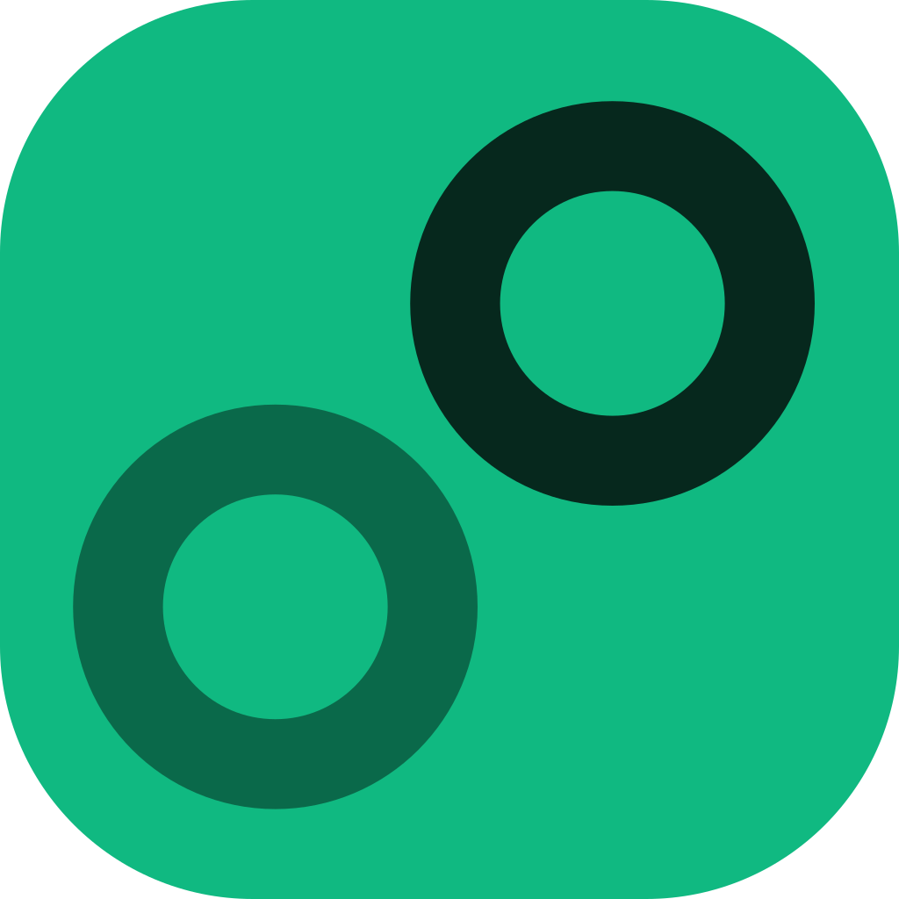
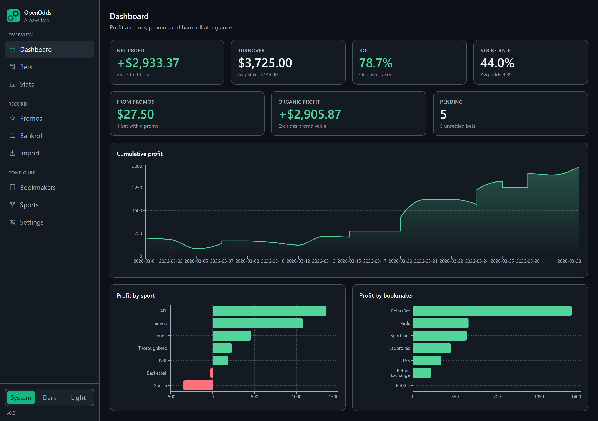
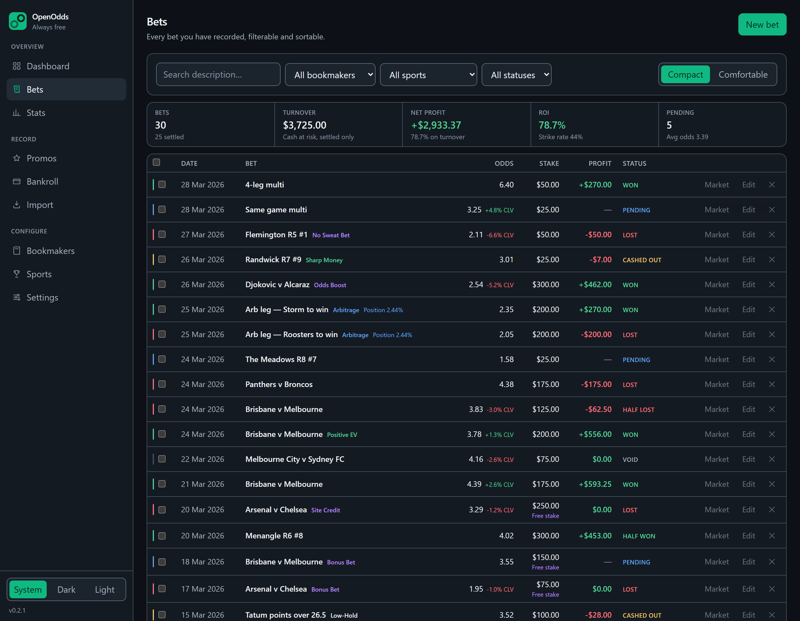

<p align="center">
  
</p>

<h1 align="center">OpenOdds</h1>

<p align="center">
  <b>Betting profit and loss, promos and bankroll</b><br>
  Free, open source, no telemetry, always.
</p>

<p align="center">
  <a href="https://github.com/GitRefDeploy/openodds/releases/latest"></a>
  
  
</p>

OpenOdds is a desktop app for keeping record of your betting. Every
bet, promo, deposit and withdrawal goes into a single SQLite file on your computer.
Nothing is uploaded anywhere and it works with no internet connection.

Built with Australian bookmakers in mind, statement dates are read day-first and the currency defaults to AUD, with the option to choose other formats.



## What it does

**Overview**

- **Dashboard** - Profit, turnover, ROI and strike rate at a glance, with promo
  earnings counted separately from the rest, a running profit curve, and where
  the profit came from by sport and by bookmaker.
- **Bets** - Every bet on one line. Search the description, or filter by
  bookmaker, sport or status.
- **Stats** - The bets that offset each other, grouped as one position, showing
  the margin the group locks in.



**Record**

- **Promos** - Profit boosts, cashback and deposit matches. A promo's value is
  held apart from organic profit, so you can see how much of your edge is
  promotional.
- **Bankroll** - Deposits, withdrawals and adjustments, with a running balance
  and a bankroll curve. Bet stakes and returns come from the bets table, so they
  are never counted twice.
- **Import** - Drop in the CSV your bookmaker exports, see what each column was
  read as before anything is written, and get any unreadable rows listed with
  their line numbers and a reason.

**Configure** 

- **Bookmakers** and **Sports** - Add your own, enable what you use.
- **Settings** - Currency, odds format, themes, an odds feed, and a
  JSON export of everything.

**In the bets themselves**

- **Formats** - single, multi and same-game multi. **Bet types** - Normal,
  Low-Hold, Arbitrage, Middle, Positive EV, Future, Sharp Money, No Sweat Bet,
  Qualifying Bet, Site Credit, Bonus Bet and Odds Boost, so bets can be grouped
  and compared later.
- **Odds in decimal, fractional or American**, stored as decimals whatever you
  pick. Win, loss, void, cashout, half-win and half-loss, with an optional
  closing price (CLV) on any bet.
- **A bonus bet is worth what it is really worth.** A $25 bonus bet at 2.40
  returns **$35**, not the $60 of cash it stands in for, because the stake was
  never your money and a win does not hand it back. Free stakes stay out of your
  turnover and ROI while the profit they earn still counts.
- **A profit boost is not an odds boost.** A profit boost takes a share of the
  profit a win would make (30 on $100 makes it $130; the odds do not move);
  cashback and a deposit match take a share of the stake, and both say so where
  you enter them. A price the bookmaker genuinely moved is the **Odds Boost** bet
  type, with the better price going into the bet's odds.
- **Positions** - group two or more bets that offset each other (an arb, a
  middle, a bonus bet hedged against a qualifying bet) and the app reports the
  **worst case across the legs**, not an average, which is the only number one of
  them actually pays. It marks the leg that sets the guarantee, and keeps
  positions still running separate from settled ones.
- **Re-importing a statement changes nothing.** Each imported row carries a
  fingerprint of its own contents, so the same statement the second time is
  recognised and skipped instead of doubling your bets.
- **Light and dark themes**, following the system or pinned by you. Every text
  pairing clears WCAG AA against every surface it can be drawn on.

## Install

Prebuilt installers are on the [releases
page](https://github.com/GitRefDeploy/openodds/releases/latest).

| Your machine | Download |
| --- | --- |
| Windows 64-bit (almost everyone) | `OpenOdds_*_x64-setup.exe` |
| Windows 32-bit | `OpenOdds_*_x86-setup.exe` |
| Windows, MSI preferred | `OpenOdds_*_x64_en-US.msi` |
| Debian, Ubuntu, Mint | `OpenOdds_*_amd64.deb` |
| Other Linux | `OpenOdds_*_amd64.AppImage` |

An AppImage needs its executable bit set before it will run:

```bash
chmod +x OpenOdds*.AppImage
./OpenOdds*.AppImage
```

> **These builds are not code-signed.** Windows will likely warn you about an
> unknown publisher - choose **More info → Run anyway**.

Once installed, **Settings → Updates** checks that same releases page for you and
installs anything newer.

## Your first few minutes

A short wizard asks for your currency, your odds format and the bookmakers you
use. Then either:

- **Import a statement.** Export a CSV from your bookmaker and drop it into
  **Import**. OpenOdds says what it read each column as, and what it could not
  read, before it writes anything.
- **Or type a bet in** - the *Get set up* checklist on the Dashboard walks you
  through a bookmaker, a bet, a deposit and an offer, and ticks each one off as
  you go.

## Your data stays yours

- Everything is in one SQLite file in your own application-data directory. There
  is no sync and no cloud, though the data model leaves room for sync later.
- API keys you enter live in the **OS credential store** (Windows Credential
  Manager, Linux Secret Service) - never in a config file, and never in this
  repository.
- The only outbound requests are to integrations you configure yourself, and only
  when you trigger them.
- **Settings → Export** writes everything to a JSON file. That export is the
  whole safety net today, so keep a copy somewhere you trust.

## Roadmap

- Racing form and results (via FormFav), so a race's form is a click away.
- Capturing the market price at the off automatically, instead of being typed or
  picked.
- General gambling tracking - pokies and table sessions - the first feature that
  is not a bet.
- Syncing between machines.

## License

[MIT](LICENSE).

## Building it yourself

Contributions are welcome. [CONTRIBUTING.md](CONTRIBUTING.md) has the ground
rules and how to run the app from source; [docs/architecture.md](docs/architecture.md)
describes how the code is put together; [docs/releases.md](docs/releases.md) covers
cutting a release.
